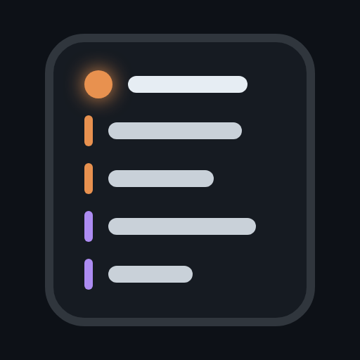
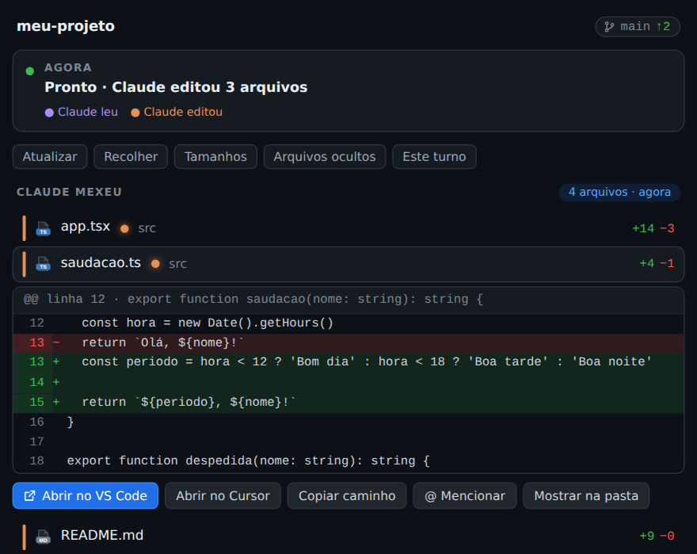
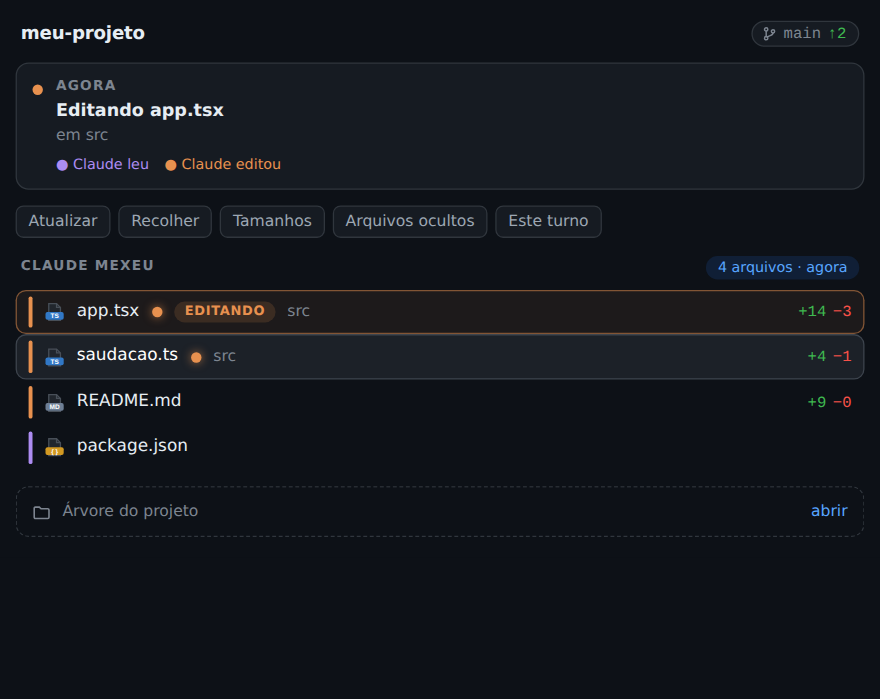
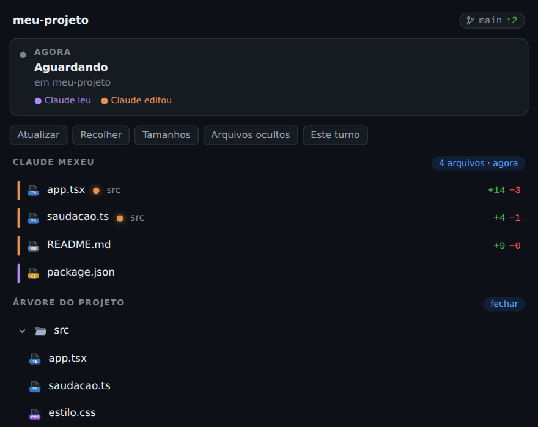

<div align="center">



# awesome-claude-panel

**A side panel for Claude Code: see at a glance what Claude touched, the diff of every file and the project tree, drawn in HTML/CSS inside Ghostty.**

[](CHANGELOG.md)
[](LICENSE)
[](https://claude.com/claude-code)
[](#requirements)

[Português](README.md) · [English](README.en.md)



</div>

> The panel's interface text is in Brazilian Portuguese for now.

---

## What it does

- **Now**: what Claude is doing right now (reading, editing, running a command, done).
- **Claude touched**: every file touched in the session, with `+N −N`.
  - The file **being edited** moves to the top with an orange border and an `EDITANDO` tag.
  - An **orange dot** marks files changed that you have not looked at yet. It disappears when you open the diff.
- **GitHub-style diff**: click a file to see removed and added lines with line numbers.
- **Actions** per file: open in VS Code, Cursor, Windsurf, Zed or Sublime; copy path; mention in the prompt; reveal in folder.
- **Project tree**: closed by default; sizes and hidden files optional.
- **Hover, smooth mouse-wheel scrolling** and automatic adjustment when you resize the terminal.
- **Lightweight**: the browser only exists while the panel is open and shuts down after 2 idle minutes.

<table>
<tr>
<td align="center"><br/><sub>File being edited and "not seen yet" dots</sub></td>
<td align="center"><br/><sub>Project tree</sub></td>
</tr>
</table>

## Requirements

| Requirement | Version | Note |
| --- | --- | --- |
| Terminal | **Ghostty** or **kitty** | Needs the kitty graphics protocol (the panel is an image). Tested on Ghostty 1.3.1. |
| OS | **Linux** or **WSL2** | Tested on Ubuntu 24.04 (Linux and WSL2). Native Windows and macOS are not supported yet. |
| Claude Code | **2.1.316 or newer** | Tested up to 2.1.319. |
| Node.js | **22 or newer** | The renderer uses Node 22's built-in WebSocket. |
| Headless Chromium | via Playwright | `npx playwright install --only-shell chromium` (one time, ~100 MB). |
| git | any | To compute diffs. |

Outside Ghostty and kitty, or inside tmux, the panel does not draw the image and shows a notice instead.

## Quick install

If you already have the terminal, Claude Code, Node 22 and Chromium:

```bash
claude plugin marketplace add brunogusta/awesome-claude-panel
claude plugin install panel@brunogusta
```

Then, inside Claude Code: `/reload-plugins` and `/panel`.

To check that the machine is ready: `node scripts/doctor.mjs`.

## Install from scratch

<details open>
<summary><b>🪟 Windows 10/11 (via WSL2): step by step</b></summary>

Ghostty has no official Windows build yet. What works is running everything **inside WSL2** (Ubuntu), which opens graphical windows on Windows through WSLg.

**1. Install WSL2 with Ubuntu** (PowerShell as administrator):

```powershell
wsl --install -d Ubuntu-24.04
wsl --update
```

Reboot if asked. Open **Ubuntu** from the Start menu and create your user. You need Windows 10 version 2004+ (build 19044 or newer) or Windows 11, with virtualization enabled in the BIOS.

**2. Prepare Ubuntu:**

```bash
sudo apt update && sudo apt install -y software-properties-common curl git
```

**3. Install Node 22:**

```bash
curl -o- https://raw.githubusercontent.com/nvm-sh/nvm/v0.40.3/install.sh | bash
# close and reopen the terminal, then:
nvm install 22
node --version   # should print v22.x
```

**4. Install Ghostty** (community package for Ubuntu):

```bash
sudo add-apt-repository ppa:mkasberg/ghostty-ubuntu
sudo apt update && sudo apt install -y ghostty
ghostty &        # opens the Ghostty window through WSLg
```

**5. Inside Ghostty, install Claude Code:**

```bash
curl -fsSL https://claude.ai/install.sh | bash
claude --version
```

(Or with npm: `npm install -g @anthropic-ai/claude-code`. See the [official docs](https://docs.claude.com/en/docs/claude-code/setup).) Run `claude` once to sign in.

**6. Install headless Chromium** (the panel uses it to draw):

```bash
npx --yes playwright install --only-shell chromium
sudo npx --yes playwright install-deps chromium   # system libraries
```

**7. Install the plugin:**

```bash
claude plugin marketplace add brunogusta/awesome-claude-panel
claude plugin install panel@brunogusta
```

**8. Open the panel:** run `claude` inside Ghostty, then `/reload-plugins` and `/panel`.

</details>

<details>
<summary><b>🐧 Linux (Ubuntu/Debian)</b></summary>

Follow steps 2 to 8 of the Windows section, skipping step 1. On other distributions, install Ghostty by [your distribution's method](https://ghostty.org/docs/install/binary) or use **kitty**.

</details>

<details>
<summary><b>🍎 macOS</b></summary>

Not supported yet: the panel keeps images in `/dev/shm` and looks for Chromium in the Linux cache. It is on the roadmap.

</details>

## Using it

| Do this | Result |
| --- | --- |
| `/panel` | Opens the panel next to the conversation. |
| Click a file in the list | Opens its diff below it. Click again to close. The orange dot goes away. |
| **Atualizar / Recolher / Tamanhos / Arquivos ocultos** buttons | Refresh, collapse folders, show sizes, show hidden files. |
| **Este turno / Sessão inteira** | Switches what the list shows (this turn / whole session). |
| **Árvore do projeto** | Opens or closes the tree. Click folders to expand. |
| Mouse wheel or arrows | Scrolls the panel. |
| **×** | Closes the panel and shuts the browser down. |

### Options

If the image looks stretched, squeezed or the text is too small, adjust in `/plugin` (the `panel` plugin tab) or with `claude plugin configure panel`:

| Option | Default | Purpose |
| --- | --- | --- |
| `cellWidth` | 13 | Width of a terminal cell, in pixels. |
| `cellHeight` | 28 | Height of a terminal cell, in pixels. |
| `pageScale` | 1.3 | Zoom of the panel text. |

### `claude agents` sessions

Those sessions do not announce image support. Run with `CLAUDE_CODE_FORCE_TERMINAL_IMAGES=1`.

## Check the installation

```bash
node scripts/doctor.mjs          # checks everything and says what is missing
node scripts/doctor.mjs --json   # same, for scripts and AI agents
```

Or without cloning: `curl -fsSL https://raw.githubusercontent.com/brunogusta/awesome-claude-panel/main/scripts/doctor.mjs | node -`

## Troubleshooting

| Symptom | Likely cause | What to do |
| --- | --- | --- |
| "O painel precisa do Ghostty ou do kitty…" | Terminal without graphics protocol, or inside tmux | Open Claude Code in Ghostty, outside tmux. |
| "Painel indisponível: Chromium não encontrado" | Headless Chromium not installed | `npx --yes playwright install --only-shell chromium` |
| "Painel indisponível: falha ao desenhar" | Missing system libraries | `sudo npx --yes playwright install-deps chromium` |
| Stretched or squeezed image | Cell size differs from the default | Adjust `cellWidth` and `cellHeight`. |
| Text too small or too large | Zoom | Adjust `pageScale`. |
| Hover is laggy | Limit of the terminal → Claude Code path | Known, see [Limitations](#limitations). |

### Diagnostics and log

The panel writes a JSON log to `~/.cache/panel/debug.log` (rotates at 5 MB). To summarize it:

```bash
node scripts/panel-log.mjs --since 30m
touch ~/.cache/panel/debug.verbose   # detailed mode (hover, scrolling)
touch ~/.cache/panel/debug.off       # turn the log off
```

When opening an [issue](https://github.com/brunogusta/awesome-claude-panel/issues), attach the output of `node scripts/doctor.mjs` and the log summary.

## Limitations

- Needs Ghostty or kitty. On Windows, only inside WSL2.
- Linux and WSL2 only for now.
- Hover highlights with a noticeable delay: every swap goes through the terminal, Claude Code and an image. The plugin already keeps ready-made frames, but it does not control that path.
- Version `0.y.z`: the API may change between minor versions (see [Versioning](#versioning)).

---

## 🤖 For AI agents (guided install)

If you are an AI installing this plugin for the user, follow this order. Stop and **ask before** any `sudo` command or system package install.

**Goal:** `claude` running inside Ghostty (or kitty) with `panel@brunogusta` installed and `/panel` working.

1. **Detect the environment** and run the checker (changes nothing):
   ```bash
   uname -sr; echo "$TERM $TERM_PROGRAM"; command -v ghostty kitty node git claude
   curl -fsSL https://raw.githubusercontent.com/brunogusta/awesome-claude-panel/main/scripts/doctor.mjs | node - --json
   ```
   Read `results[]`: each item has `id`, `status` (`ok`, `warn`, `fail`), `message` and `fix` (the command that solves it).
2. **Decide by system:**
   - Native Windows (PowerShell): not supported. Guide the user to install WSL2 (`wsl --install -d Ubuntu-24.04`, as administrator, reboot) and **continue inside Ubuntu**.
   - macOS: not supported. Tell the user.
   - Linux or WSL2: go ahead.
3. **Fix each `fail`** in this order: `so` → `node` (22+, via nvm) → `git` → `terminal` (install Ghostty: `ppa:mkasberg/ghostty-ubuntu`) → `claude` → `chromium` → `shm`. Use the given `fix`, then run the checker again.
4. **Install the plugin** (skip if `plugin` is already `ok`):
   ```bash
   claude plugin marketplace add brunogusta/awesome-claude-panel
   claude plugin install panel@brunogusta
   ```
5. **Confirm:** `claude plugin list` must contain `panel@brunogusta`. Ask the user to, **inside Ghostty**, open `claude`, run `/reload-plugins` and `/panel`, and tell you whether the panel shows up.
6. **If it fails,** ask for the output of `node scripts/doctor.mjs` and `node scripts/panel-log.mjs --since 30m` (file `~/.cache/panel/debug.log`).

**Rules for the agent:**
- You cannot see the panel: it only exists in the user's terminal. Ask the user to confirm.
- Never hand-edit `~/.claude/settings.json`; use the `claude plugin ...` commands.
- Do not run Claude Code inside tmux (the panel does not draw there).
- To uninstall: `claude plugin uninstall panel@brunogusta` and, optionally, `claude plugin marketplace remove brunogusta`.

---

## How it works (summary)

A small Node server keeps a headless Chromium; the plugin builds the HTML/CSS page from session data, Chromium photographs it to a PNG, and Claude Code shows the image in the terminal through the kitty graphics protocol. Clicks and hover become actions because the plugin knows where every button sits on the page. Details in [`docs/ARCHITECTURE.md`](docs/ARCHITECTURE.md) (Portuguese).

## Development

```bash
git clone https://github.com/brunogusta/awesome-claude-panel && cd awesome-claude-panel
claude plugin test .                 # plugin tests
claude plugin validate .             # manifests and hooks
node --test tests/server.check.mjs tests/scenarios.check.mjs   # server with real Chromium
bun scripts/screenshots.ts           # regenerates this README's images
claude --plugin-dir .                # run the plugin straight from the folder
```

Formal proofs live in [`formal/`](formal/README.md) (Lean 4 and TLA+).

## Versioning

This project follows [Semantic Versioning 2.0.0](https://semver.org/) and [Keep a Changelog](https://keepachangelog.com/en/1.1.0/). While the version is `0.y.z`, the API may change between minor versions.

- **Public API:** the commands (`/panel`), the options (`cellWidth`, `cellHeight`, `pageScale`) and the minimum requirements above.
- **MAJOR** breaks existing users; **MINOR** adds something compatible; **PATCH** fixes a bug.
- The version lives in `.claude-plugin/plugin.json`; Claude Code only offers an update when that number goes up.
- Every version has a `vX.Y.Z` tag and a [release](https://github.com/brunogusta/awesome-claude-panel/releases). History is in [`CHANGELOG.md`](CHANGELOG.md).
- `node scripts/check-version.mjs` checks that version, changelog and tag agree.

To update the plugin: `claude plugin marketplace update brunogusta && claude plugin update panel@brunogusta`.

## License

[MIT](LICENSE) © 2026 brunogusta
