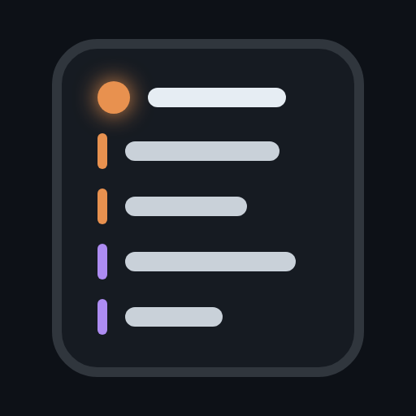
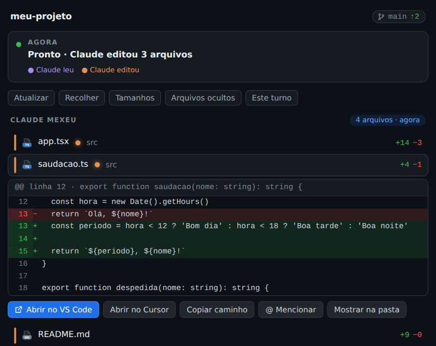
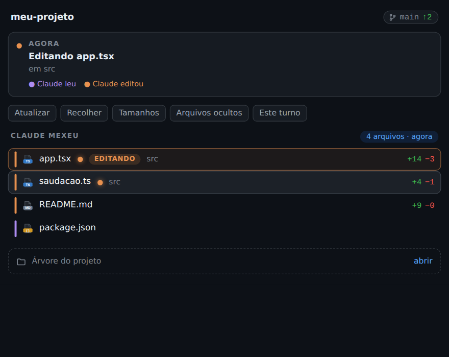
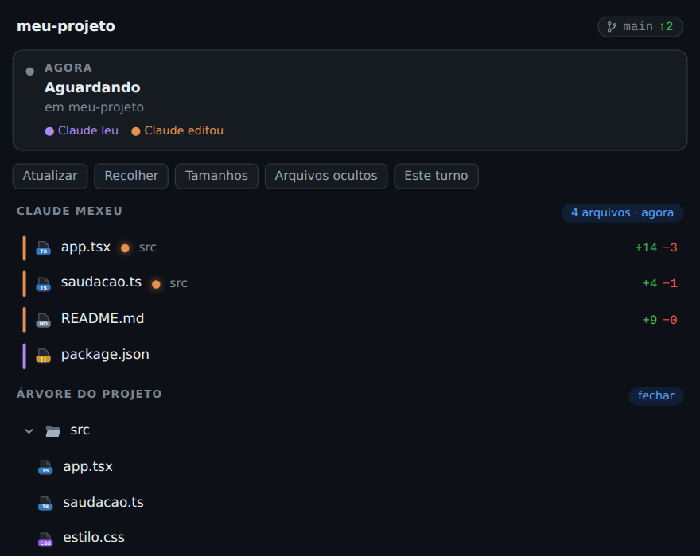

<div align="center">



# awesome-claude-panel

**Um painel lateral para o Claude Code: veja na hora o que o Claude mexeu, o diff de cada arquivo e a árvore do projeto, desenhado em HTML/CSS dentro do Ghostty.**

[](CHANGELOG.md)
[](LICENSE)
[](https://claude.com/claude-code)
[](#requisitos)

[Português](README.md) · [English](README.en.md)



</div>

---

## O que ele faz

- **Agora**: o que o Claude está fazendo neste instante (lendo, editando, rodando um comando, pronto).
- **Claude mexeu**: todos os arquivos tocados na sessão, com `+N −N`.
  - O arquivo **em edição** sobe para o topo, com borda laranja e a etiqueta `EDITANDO`.
  - Uma **bolinha laranja** marca o que foi alterado e você ainda não viu. Ela some quando você abre o diff.
- **Diff estilo GitHub**: clique no arquivo e veja linhas removidas e adicionadas, com números de linha.
- **Ações** em cada arquivo: abrir no VS Code, Cursor, Windsurf, Zed ou Sublime; copiar o caminho; mencionar no prompt; mostrar na pasta.
- **Árvore do projeto**: fechada por padrão, abre quando você quer. Tamanhos e arquivos ocultos opcionais.
- **Hover, rolagem suave pela roda do mouse** e ajuste automático quando você muda o tamanho do terminal.
- **Leve**: o navegador só existe enquanto o painel está aberto e desliga sozinho depois de 2 minutos parado.

<table>
<tr>
<td align="center"><br/><sub>Arquivo em edição e bolinhas de "ainda não visto"</sub></td>
<td align="center"><br/><sub>Árvore do projeto</sub></td>
</tr>
</table>

## Requisitos

| Requisito | Versão | Observação |
| --- | --- | --- |
| Terminal | **Ghostty** ou **kitty** | Precisam do protocolo gráfico do kitty (o painel é uma imagem). Testado no Ghostty 1.3.1. |
| Sistema | **Linux** ou **WSL2** | Testado no Ubuntu 24.04 (Linux e WSL2). Windows nativo e macOS ainda não são suportados. |
| Claude Code | **2.1.316 ou mais novo** | Testado até a 2.1.319. |
| Node.js | **22 ou mais novo** | O desenhista usa o WebSocket nativo do Node 22. |
| Chromium headless | via Playwright | `npx playwright install --only-shell chromium` (instalado uma vez, ~100 MB). |
| git | qualquer | Para calcular os diffs. |

Fora do Ghostty e do kitty, ou dentro do tmux, o painel não desenha a imagem e mostra um aviso.

## Instalação rápida

Se você já tem terminal, Claude Code, Node 22 e o Chromium:

```bash
claude plugin marketplace add brunogusta/awesome-claude-panel
claude plugin install panel@brunogusta
```

Depois, dentro do Claude Code: `/reload-plugins` e `/panel`.

Para conferir se a máquina está pronta: `node scripts/doctor.mjs` (veja [Verificar a instalação](#verificar-a-instalação)).

## Instalação do zero

<details open>
<summary><b>🪟 Windows 10/11 (via WSL2): passo a passo</b></summary>

O Ghostty ainda não tem versão oficial para Windows. O caminho que funciona é rodar tudo **dentro do WSL2** (Ubuntu), que abre janelas gráficas no Windows pelo WSLg.

**1. Instale o WSL2 com Ubuntu** (PowerShell como administrador):

```powershell
wsl --install -d Ubuntu-24.04
wsl --update
```

Reinicie o Windows se pedir. Abra o **Ubuntu** no menu Iniciar e crie seu usuário e senha. É preciso Windows 10 versão 2004+ (build 19044 ou mais novo) ou Windows 11, com a virtualização ligada na BIOS.

**2. Prepare o Ubuntu** (no terminal do Ubuntu):

```bash
sudo apt update && sudo apt install -y software-properties-common curl git
```

**3. Instale o Node 22:**

```bash
curl -o- https://raw.githubusercontent.com/nvm-sh/nvm/v0.40.3/install.sh | bash
# feche e abra o terminal, depois:
nvm install 22
node --version   # deve mostrar v22.x
```

**4. Instale o Ghostty** (pacote da comunidade para Ubuntu):

```bash
sudo add-apt-repository ppa:mkasberg/ghostty-ubuntu
sudo apt update && sudo apt install -y ghostty
ghostty &        # abre a janela do Ghostty pelo WSLg
```

**5. Dentro do Ghostty, instale o Claude Code:**

```bash
curl -fsSL https://claude.ai/install.sh | bash
claude --version
```

(Se preferir o npm: `npm install -g @anthropic-ai/claude-code`. Veja a [documentação oficial](https://docs.claude.com/en/docs/claude-code/setup).) Rode `claude` uma vez para entrar na sua conta.

**6. Instale o Chromium headless** (o painel usa para desenhar):

```bash
npx --yes playwright install --only-shell chromium
sudo npx --yes playwright install-deps chromium   # bibliotecas do sistema
```

**7. Instale o plugin:**

```bash
claude plugin marketplace add brunogusta/awesome-claude-panel
claude plugin install panel@brunogusta
```

**8. Abra o painel:** rode `claude` dentro do Ghostty, depois `/reload-plugins` e `/panel`.

> Dica: para abrir o Ghostty direto de um atalho do Windows, crie um atalho para
> `wsl.exe -d Ubuntu-24.04 -- ghostty`.

</details>

<details>
<summary><b>🐧 Linux (Ubuntu/Debian)</b></summary>

Siga os passos 2 a 8 da seção do Windows, sem o passo 1. Em outras distribuições, instale o Ghostty pelo
[método da sua distribuição](https://ghostty.org/docs/install/binary) ou use o **kitty**.

</details>

<details>
<summary><b>🍎 macOS</b></summary>

Ainda não é suportado: o painel guarda as imagens em `/dev/shm` e procura o Chromium no cache do Linux. Está no roteiro.

</details>

## Usar

| Faça | Resultado |
| --- | --- |
| `/panel` | Abre o painel ao lado da conversa. |
| Clicar num arquivo da lista | Abre o diff embaixo dele. Clicar de novo fecha. A bolinha laranja some. |
| Botões **Atualizar / Recolher / Tamanhos / Arquivos ocultos** | Recarrega, fecha as pastas, mostra tamanhos, mostra ocultos. |
| **Este turno / Sessão inteira** | Troca o que a lista mostra. |
| **Árvore do projeto** | Abre ou fecha a árvore. Clique nas pastas para expandir. |
| Roda do mouse ou setas | Rola o painel. |
| Fechar no **×** | Fecha o painel e desliga o navegador. |

### Opções

Se a imagem sair esticada, espremida ou com texto pequeno, ajuste pelo `/plugin` (aba do plugin `panel`) ou por `claude plugin configure panel`:

| Opção | Padrão | Para quê |
| --- | --- | --- |
| `cellWidth` | 13 | Largura de uma célula do terminal, em pixels. |
| `cellHeight` | 28 | Altura de uma célula, em pixels. |
| `pageScale` | 1.3 | Zoom do texto do painel. |

### Sessões do `claude agents`

Nessas sessões o terminal não anuncia imagens. Rode com `CLAUDE_CODE_FORCE_TERMINAL_IMAGES=1`.

## Verificar a instalação

```bash
node scripts/doctor.mjs          # confere tudo e diz o que falta
node scripts/doctor.mjs --json   # a mesma coisa, para scripts e agentes de IA
```

Se você instalou só pelo marketplace, o script fica na pasta do plugin (`~/.claude/plugins`). Ou baixe-o:
`curl -fsSL https://raw.githubusercontent.com/brunogusta/awesome-claude-panel/main/scripts/doctor.mjs | node -`

## Solução de problemas

| Sintoma | Causa provável | O que fazer |
| --- | --- | --- |
| "O painel precisa do Ghostty ou do kitty…" | Terminal sem protocolo gráfico, ou dentro do tmux | Abra o Claude Code no Ghostty, fora do tmux. |
| "Painel indisponível: Chromium não encontrado" | Chromium headless não instalado | `npx --yes playwright install --only-shell chromium` |
| "Painel indisponível: falha ao desenhar" | Faltam bibliotecas do sistema | `sudo npx --yes playwright install-deps chromium` |
| Imagem esticada ou espremida | Tamanho da célula diferente do padrão | Ajuste `cellWidth` e `cellHeight`. |
| Texto muito pequeno ou grande | Zoom | Ajuste `pageScale`. |
| O painel não muda ao redimensionar | Redesenho em andamento | Espere ~1 s; se persistir, mande o log (abaixo). |
| O hover tem atraso | Limite do caminho terminal → Claude Code | Conhecido, veja [Limitações](#limitações). |

### Diagnóstico e log

O painel grava um log em JSON em `~/.cache/panel/debug.log` (gira aos 5 MB). Para resumir:

```bash
node scripts/panel-log.mjs --since 30m
touch ~/.cache/panel/debug.verbose   # liga o modo detalhado (hover, rolagem)
touch ~/.cache/panel/debug.off       # desliga o log
```

Ao abrir uma [issue](https://github.com/brunogusta/awesome-claude-panel/issues), anexe a saída de `node scripts/doctor.mjs` e do resumo do log.

## Limitações

- Precisa de Ghostty ou kitty. No Windows, só dentro do WSL2.
- Linux e WSL2 apenas por enquanto.
- O hover mostra o destaque com atraso perceptível: cada troca passa pelo terminal, pelo Claude Code e por uma imagem. O plugin já guarda os quadros prontos, mas não controla esse caminho.
- Versão `0.y.z`: a API pode mudar entre versões menores (veja [Versionamento](#versionamento)).

---

## 🤖 Para agentes de IA (instalação guiada)

Se você é uma IA instalando este plugin para o usuário, siga esta ordem. Pare e **pergunte antes** de qualquer comando com `sudo` ou que instale pacotes do sistema.

**Objetivo:** deixar `claude` dentro do Ghostty (ou kitty) com o plugin `panel@brunogusta` instalado e o comando `/panel` funcionando.

1. **Detecte o ambiente** e rode o verificador (não altera nada):
   ```bash
   uname -sr; echo "$TERM $TERM_PROGRAM"; command -v ghostty kitty node git claude
   curl -fsSL https://raw.githubusercontent.com/brunogusta/awesome-claude-panel/main/scripts/doctor.mjs | node - --json
   ```
   Leia `results[]`: cada item tem `id`, `status` (`ok`, `warn`, `fail`), `message` e `fix` (o comando que resolve).
2. **Decida pelo sistema:**
   - Windows nativo (PowerShell): não suportado. Guie o usuário a instalar o WSL2 (`wsl --install -d Ubuntu-24.04`, como administrador, reiniciar) e **continue dentro do Ubuntu**.
   - macOS: não suportado. Avise o usuário.
   - Linux ou WSL2: siga adiante.
3. **Resolva cada `fail`** na ordem: `so` → `node` (22+, via nvm) → `git` → `terminal` (instalar Ghostty: `ppa:mkasberg/ghostty-ubuntu`) → `claude` → `chromium` → `shm`. Use o `fix` indicado e rode o verificador de novo.
4. **Instale o plugin** (ou, se `plugin` já for `ok`, pule):
   ```bash
   claude plugin marketplace add brunogusta/awesome-claude-panel
   claude plugin install panel@brunogusta
   ```
5. **Confirme:** `claude plugin list` deve conter `panel@brunogusta`. Peça ao usuário para, **dentro do Ghostty**, abrir o `claude`, rodar `/reload-plugins` e `/panel` e dizer se o painel aparece.
6. **Se falhar,** peça a saída de `node scripts/doctor.mjs` e de `node scripts/panel-log.mjs --since 30m` (arquivo `~/.cache/panel/debug.log`).

**Regras para o agente:**
- Você não consegue ver o painel: ele só existe no terminal do usuário. Peça confirmação a ele.
- Nunca edite `~/.claude/settings.json` à mão; use os comandos `claude plugin ...`.
- Não rode o Claude Code dentro de tmux (o painel não desenha lá).
- Para desinstalar: `claude plugin uninstall panel@brunogusta` e, se quiser, `claude plugin marketplace remove brunogusta`.

---

## Como funciona (resumo)

Um servidor Node pequeno mantém um Chromium headless; o plugin monta a página HTML/CSS com os dados da sessão, o Chromium a fotografa em PNG e o Claude Code mostra a imagem no terminal pelo protocolo gráfico do kitty. Cliques e hover viram ações porque o plugin conhece a posição de cada botão na página. Detalhes em [`docs/ARCHITECTURE.md`](docs/ARCHITECTURE.md).

## Desenvolvimento

```bash
git clone https://github.com/brunogusta/awesome-claude-panel && cd awesome-claude-panel
claude plugin test .                 # testes do plugin
claude plugin validate .             # manifestos e hooks
node --test tests/server.check.mjs tests/scenarios.check.mjs   # servidor com o Chromium de verdade
bun scripts/screenshots.ts           # regenera as imagens deste README
claude --plugin-dir .                # roda o plugin direto da pasta
```

As provas formais ficam em [`formal/`](formal/README.md) (Lean 4 e TLA+).

## Versionamento

O projeto segue o [Versionamento Semântico 2.0.0](https://semver.org/lang/pt-BR/) e o [Keep a Changelog](https://keepachangelog.com/pt-BR/1.1.0/). Enquanto a versão for `0.y.z`, a API pode mudar entre versões menores.

- **API pública:** os comandos (`/panel`), as opções (`cellWidth`, `cellHeight`, `pageScale`) e os requisitos mínimos acima.
- **MAJOR** quebra quem já usa; **MINOR** acrescenta algo compatível; **PATCH** corrige bug.
- A versão vive em `.claude-plugin/plugin.json`; o Claude Code só oferece atualização quando esse número sobe.
- Cada versão tem uma tag `vX.Y.Z` e uma [release](https://github.com/brunogusta/awesome-claude-panel/releases). O histórico está em [`CHANGELOG.md`](CHANGELOG.md).
- `node scripts/check-version.mjs` confere que versão, changelog e tag concordam.

Para atualizar o plugin: `claude plugin marketplace update brunogusta && claude plugin update panel@brunogusta`.

## Licença

[MIT](LICENSE) © 2026 brunogusta
